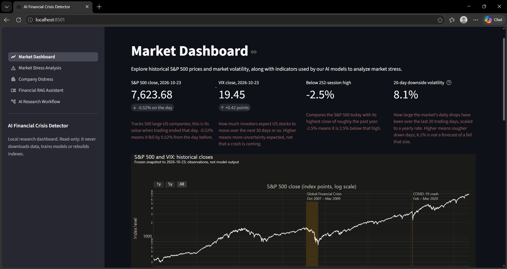
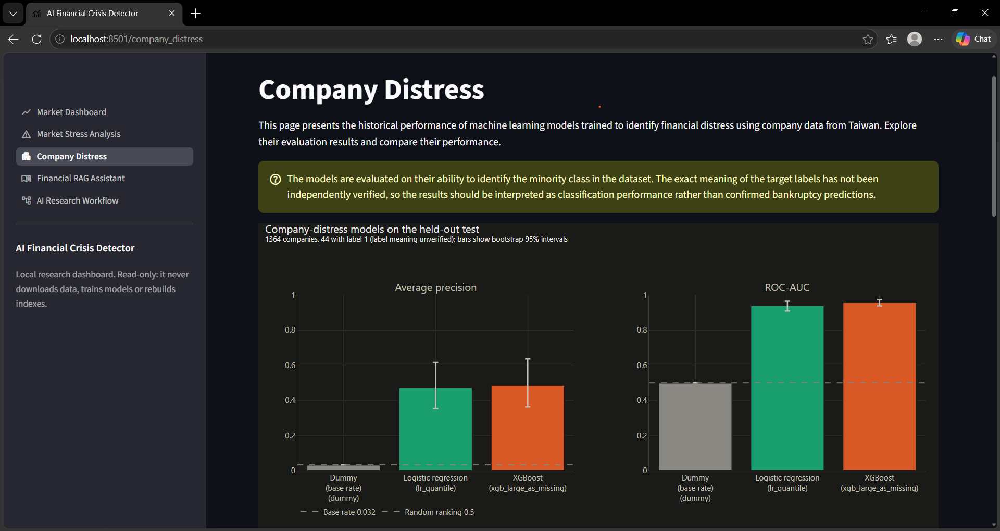
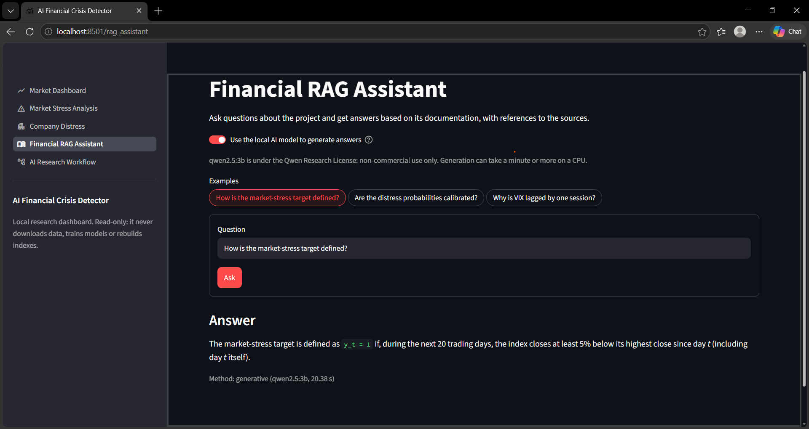
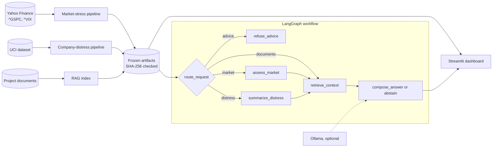

# AI Financial Crisis Detector

A local, offline-first research system for financial risk analysis. It scores
S&P 500 market stress, evaluates company-distress classifiers, answers
questions about its own methodology with cited sources, and brings these
together in a LangGraph workflow and a Streamlit dashboard.

Everything runs on a laptop CPU: no paid APIs, cloud services, Docker or
fine-tuning. The design favours evaluation discipline over headline numbers.
The project uses chronological splits with purge gaps and frozen,
checksum-verified results, and every design decision is recorded in
`docs/decisions.md` (D1–D37).

> **Disclaimer:** this is a research and educational project. Its outputs are
> probabilistic estimates with known limitations, not forecasts or financial
> advice, and they do not guarantee any financial outcome.

## What it does

- **Market stress** (D2, D10–D13): scores the risk that the S&P 500 closes
  at least 5% below its running high within the next 20 trading days. Inputs
  are 16 backward-looking S&P 500 and VIX features; the 1990–2026 history
  comes from a frozen snapshot.
- **Company distress** (D4, D8, D9): baseline classifiers on the UCI
  Taiwanese Bankruptcy dataset, with leakage-safe preprocessing and repeated
  stratified CV.
- **Document RAG** (D14–D16, D30–D33): answers questions about the project's
  documents with numbered citations, or says the evidence is insufficient.
  It uses local embeddings, a cross-encoder reranker and an optional local
  LLM, whose answers must pass grounding checks.
- **Workflow** (D17): a LangGraph graph that routes each question to the
  market signal, the distress results or the documents, and declines
  requests for investment advice.
- **Dashboard** (D18–D21, D29): a local Streamlit and Plotly app with five
  pages over all of the above. It is read-only and never retrains,
  downloads or rebuilds.

| Market Dashboard | Company Distress |
|---|---|
|  |  |



## Data sources

- **Market data:** [Yahoo Finance](https://finance.yahoo.com/) (D10)
- **Company data:** [UCI Machine Learning Repository](https://archive.ics.uci.edu/) (D4)

## Results

These are historical results of frozen models. Each held-out test set was
evaluated in a single recorded run, after model selection was frozen, and
has not been used for tuning since. The records cannot rule out an earlier
inspection of the market-stress test set (D34).

**Market stress:** held-out test 2015-01-02 to 2026-09-25 (2,950 trading
days; base rate 0.212). The models were selected on 15 walk-forward
validation years (2000–2014).

| Model | Average precision | ROC-AUC |
|---|---|---|
| Rule: 20-day downside volatility (primary) | 0.363 | 0.677 |
| Rule: VIX 252-day percentile | 0.357 | 0.686 |
| XGBoost | 0.354 | 0.673 |
| Logistic regression | 0.321 | 0.627 |
| Dummy (base rate) | 0.212 | 0.500 |

All models beat the base rate. No fitted model clearly beat the simple
downside-volatility rule, and the signal is weak, with many false alarms.
Methodological questions recorded in the Phase B audit (D34) remain open,
and decision thresholds are treated as valid for the rule baselines only
(D35).

**Company distress:** held-out test of 1,364 companies, 44 with label 1.

| Model | Average precision | ROC-AUC |
|---|---|---|
| XGBoost (large values as missing) | 0.487 | 0.958 |
| Logistic regression (quantile transform) | 0.472 | 0.940 |
| Dummy | 0.032 | 0.500 |

The test set does not distinguish the two models. UCI does not document what
the target labels mean, so these are classification results, not confirmed
bankruptcy predictions (`docs/model_card.md`).

**Document RAG retrieval:** development set only (26 answerable and 6
unanswerable questions): hit@1 0.462, hit@3 0.654, hit@5 0.846, MRR 0.583.
These numbers come from questions used to develop the system, so they are
optimistic. A new held-out question set is needed to confirm them.

## How it works

- **No look-ahead.**
  - Features for day *t* use closes up to *t*; the VIX is lagged one
    session.
  - Labels use only the next 20 sessions.
  - Training ends 20 sessions before each validation year and before the
    test period.
  - Tests check each of these rules (`tests/test_market_*.py`).
- **Frozen evidence.** Raw data, datasets, predictions, models and
  evaluation sets are checked against recorded SHA-256 checksums. The code
  must reproduce the frozen features and scores exactly (D22, D23).
- **Grounded answers.**
  - Extractive answers quote retrieved sentences with citations.
  - Generated answers are kept only if every sentence cites retrieved
    evidence, and its numbers and most of its words appear there.
  - A question is refused when no passage reaches a fixed relevance
    threshold.
- **Local only.** The dashboard binds to `localhost`, with usage
  statistics off. Models are loaded from the local cache, and downloads
  need an explicit flag.

See `docs/architecture.md` for the component diagram and `docs/model_card.md`
for the company-distress model card.

## Architecture



## Tech stack

- **Language:** Python 3.12.
- **Models:** scikit-learn, XGBoost, pandas, NumPy.
- **Retrieval:** sentence-transformers (`all-MiniLM-L6-v2` embeddings and the
  `ms-marco-MiniLM-L-6-v2` cross-encoder), FAISS, LangChain document
  interfaces.
- **Workflow:** LangGraph.
- **Local LLM:** Ollama with `qwen2.5:3b` (optional; non-commercial licence).
- **App:** Streamlit and Plotly.
- **Data:** yfinance (an unofficial Yahoo Finance client).

## Quick start (Windows)

```powershell
py -3.12 -m venv .venv
.\.venv\Scripts\python.exe -m pip install -r requirements-lock.txt --extra-index-url https://download.pytorch.org/whl/cpu
.\.venv\Scripts\python.exe -m pip install -e . --no-deps
```

The data, frozen results and trained models live under `data/` and
`artifacts/` and are not committed. To regenerate them, follow the pipeline
in `docs/model_card.md` (section 12) and D10–D13. Then build the document
index once; the first run downloads the embedding and reranker models:

```powershell
.\.venv\Scripts\python.exe -B scripts\build_rag_index.py --allow-download
```

Launch the dashboard from the project root, so `.streamlit/config.toml` is
used, and open http://localhost:8501:

```powershell
.\.venv\Scripts\python.exe -m streamlit run app\streamlit_app.py
```

## Using it

**Dashboard pages:**
- Market Dashboard;
- Market Stress Analysis;
- Company Distress;
- Financial RAG Assistant;
- AI Research Workflow.

Missing or altered artifacts are reported with instructions to fix them,
not shown. The optional "local AI model" toggles need Ollama running with
`qwen2.5:3b`.

**Workflow from the command line:**

```powershell
.\.venv\Scripts\python.exe -B scripts\run_crisis_agent.py "What is the current market stress level?"
.\.venv\Scripts\python.exe -B scripts\run_crisis_agent.py "How well do the bankruptcy models perform?"
.\.venv\Scripts\python.exe -B scripts\run_crisis_agent.py "Which VIX value is used for date t?"
```

- **Advice:** requests for investment or trading advice are declined
  without running any tool, for example "Should I sell my stocks now?".
- **Snapshot age:** the market answer reads the frozen snapshot and warns
  when it is more than 7 days old.
- **Options:** add `--json` for the route taken, or `--llm ollama` to let the
  local model write document answers.

**RAG from the command line:**

```powershell
.\.venv\Scripts\python.exe -B scripts\ask_rag.py "What is the VIX alignment rule?"
.\.venv\Scripts\python.exe -B scripts\ask_rag.py "What is the VIX alignment rule?" --llm ollama
.\.venv\Scripts\python.exe -B scripts\evaluate_rag.py
```

**Evaluation sets:**
- **Default:** the evaluation scripts use the development questions
  (`knowledge_base/eval/retrieval_questions.json`).
- **Validation set:** it has already been used, so the scripts refuse it,
  even under another name, unless `--final-validation` is given (D24).
- **Your own documents:** add `.md` or `.txt` files under
  `knowledge_base/documents/`, then rebuild with
  `scripts\build_rag_index.py --force`.

## Quality checks

Run the unit tests alone (`unittest`, as the QA runner does):

```powershell
.\.venv\Scripts\python.exe -B -m unittest discover -s tests
```

One read-only command runs every check and the test suite (D22–D28):

```powershell
.\.venv\Scripts\python.exe -B scripts\run_qa.py            # everything (about 5 minutes on CPU)
.\.venv\Scripts\python.exe -B scripts\run_qa.py --quick    # the checks only, without the test suite
.\.venv\Scripts\python.exe -B scripts\run_qa.py --live     # also the live Ollama and dashboard-server tests
```

| Stage | Checks |
|---|---|
| environment | installed packages match `requirements-lock.txt` |
| integrity | frozen data, results, models and evaluation sets match their recorded checksums |
| reproducibility | today's code reproduces the frozen features, target, model scores and latest signal |
| rag regression | development-set retrieval and reference answers match their reviewed baselines |
| tests | about 380 unit and integration tests |

**After editing an indexed document** (this README, `docs/` or the reports):
1. Rebuild the index.
2. Run `scripts\check_rag_regression.py` and review what it reports.
3. Only then re-record the baselines with `--update`.

## Key settings

All settings live in `config/settings.yaml`. They differ in what a change
would mean for the reported results:

| Setting | Value | Effect of a change |
|---|---|---|
| `market_stress_target` (`horizon_trading_days`, `drawdown_threshold`) | 20, 0.05 | Redefines the label (D2), so it is a different problem. The reproducibility check rebuilds the target with these values and would no longer match the frozen dataset. |
| `evaluation.purge_gap_trading_days` | 20 | Gap between training and evaluation rows; must be at least the horizon, or labels overlap the next block. |
| `market_stress` validation years, `test_start` | 2000–2014, 2015-01-01 | Define the walk-forward and held-out splits (D12). Results on other splits are not comparable with the reported ones. |
| `market.end_date` | 2026-10-23 | Last date of the frozen snapshot (D10). |
| `company_distress` (`test_size`, `cv_folds`, `cv_repeats`) and `project.random_seed` | 0.2, 5, 3, 42 | Define the held-out companies and the CV folds (D8, D9). |
| Model hyperparameters (`logistic_regression`, `xgboost`) | fixed, not tuned | Used only when training. The frozen models are loaded from `artifacts/`, so editing them changes nothing until a retrain, which would be a new experiment. |
| `rag` chunking, `embedding_model`, `retrieval.mode`, `rerank_candidates`, `top_k` | see file | Change what is retrieved. Rebuild the index and run `check_rag_regression.py`; the development baselines in `config/qa/` were recorded with the current values. |
| `rag.min_relevance` | 0.30 | Below this score, the answer is "insufficient evidence"; it changes which questions are refused. |
| `rag.ollama.options` | temperature 0, seed 42 | Deterministic decoding for the optional local LLM only; the regression checks use extractive answers. |
| `agent.stale_after_days` | 7 | Only the age at which the stale-snapshot warning appears; no metric depends on it. |

## Limitations

- **Market stress:**
  - the signal is weak, and the 2015–2026 test set has already been used;
  - any new model or threshold needs data that has not been used, which in
    practice means forward data collected after the snapshot;
  - fitted-model thresholds are not transferable (D35);
  - the D34 questions on aggregation and on overlapping labels are open.
- **Company distress:**
  - the labels are unverified;
  - the data covers Taiwanese companies from 1999–2009 only, with no
    company identifier;
  - the probabilities are not calibrated.
- **RAG:**
  - small local models with development-set metrics only;
  - only 3 of the 6 unanswerable development questions are refused; the
    others get off-topic answers;
  - some answers include an off-topic sentence;
  - tables of numbers and the full feature list are hard to retrieve;
  - known cases are listed in D32 and D33.
- **Data:** Yahoo Finance data is unofficial and can be revised; the
  snapshot is frozen with checksums.

## Future work

Not implemented; each item follows from a limitation above.

- Collect market data after the frozen snapshot, to test any new model or
  threshold on data that has not been used.
- Settle the open D34 questions on aggregation and overlapping labels.
- Calibrate the company-distress probabilities, and find documentation of
  what the UCI labels mean.
- Write a new held-out RAG question set to confirm the development-set
  retrieval metrics.
- Improve refusals on unanswerable questions and retrieval of numeric
  tables.

## Licensing and attribution

- **Code:** the repository has no `LICENSE` file, so no license is granted
  for its code.
- **Market data:** Yahoo Finance through yfinance, an unofficial client not
  affiliated with Yahoo. The data is subject to Yahoo's terms and is not
  committed to this repository.
- **Models:** `all-MiniLM-L6-v2` and `ms-marco-MiniLM-L-6-v2` are
  Apache-2.0. The optional `qwen2.5:3b` is under the Qwen Research License,
  for non-commercial use only.

## Project layout

| Path | Purpose |
|---|---|
| `config/settings.yaml` | Tickers, target definition, seeds, paths, model and RAG settings |
| `src/fincrisis/` | Project logic: data, features, models, evaluation, RAG, agents, QA |
| `scripts/` | Command-line entry points |
| `app/` | Streamlit dashboard (`streamlit_app.py`, pages in `views/`) |
| `tests/` | Automated tests, including leakage guards |
| `docs/` | Architecture, design decisions (D1–D37) and the model card |
| `config/qa/`, `config/frozen_artifacts.json` | Reviewed RAG baselines and frozen-artifact checksums |
| `data/`, `artifacts/` | Local data, results and trained models (not committed) |
